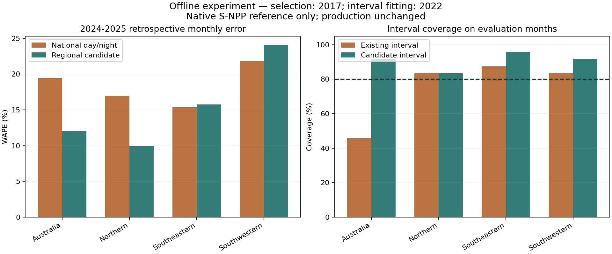

# Regional calibration experiment

**Offline candidate; production unchanged.** No new external data, APIs, dependencies or downloads. Training parameters and reference-month selection were rebuilt from existing QC-passed native records.

## Protocol and limits

All complete overlap years were previously used in production refitting. 2024-2025 are retrospective holdouts for this experiment, not globally untouched project data. 2019-2021 were already inspected and are not used for selection or final scoring.

Training: 2013, 2016, 2018, 2023. Selection: 2017. Residual interval fitting: 2022. Evaluation: available native S-NPP months in 2024-2025. Model choice and interval parameters were saved before evaluation. Historical, non-chronological splitting is retrospective transfer evaluation, not a prospective forecast.

The candidates use a national day/night ratio or ratios by calendar month, 10-degree geographic tile, tile/quarter, or tile/month. Sparse groups shrink toward the national ratio with 500 or 5000 MODIS-count prior strength. The selection objective balances national, pooled 0.5-degree and fixed-sample WAPE; national degradation is limited to 2 percentage points.

Selected model: **tile_quarter_500**. Evaluation months: 24. Geographic samples are rectangles, not biome masks or spatial holdouts.

| Sample | National-ratio WAPE | Candidate WAPE | Existing interval coverage | Candidate interval coverage |
|---|---:|---:|---:|---:|
| Australia | 19.5% | 12.0% | 45.8% | 91.7% |
| Northern Australia sample | 16.9% | 10.0% | 83.3% | 83.3% |
| Southeastern Australia sample | 15.4% | 15.8% | 87.5% | 95.8% |
| Southwestern Australia sample | 21.8% | 24.1% | 83.3% | 91.7% |

## Interpretation

Compare every region, interval width and handoff residual in results.json; improvement in a pooled selection score is not a deployment guarantee. The baseline ratios are rebuilt on experiment training years. Existing interval parameters were previously fit on 2017/2022, while candidate intervals use 2022 only, so uncertainty comparisons are not matched-budget experiments. Neither interval uses 2024/2025 outcomes.

Candidate variance is phi*(prediction+1)+alpha*(prediction+1)^2 with nonnegative coefficients, estimated from 2022 residuals. Each fixed area gets the finite-sample corrected 80% quantile of monthly standardized errors. Serial dependence and only one calibration year prevent a universal coverage guarantee. These area-specific intervals must not be presented as calibrated for arbitrary drawn polygons. Clipped lower bounds avoid negative counts. Satellite measurement/omission and scaling uncertainty are not included.

Months failing the pooled native S-NPP availability check are excluded, not filled with production-scaled NOAA values. The detection-count availability check does not establish cloud-free or daily viewing exposure. All skipped year/month combinations are identifiable from evaluated_months in results.json.

No Terra-only (2000-2002) model was changed. No automatic history updates were added. Production replacement needs further evidence and a compatible arbitrary-area uncertainty design. No complete year in this supplied archive can be called never-used project data; new prospective observations would be needed for that stronger claim.

## Files and reproducibility

protocol.json records the specification and script hash. frozen-selection.json records all selection scores and safe JSON model tables. frozen-intervals.json records uncertainty parameters saved before evaluation. monthly.csv provides evaluation values and intervals. results.json contains per-area errors, widths, coverage and handoff diagnostics.

Run `.venv/Scripts/python -m pipeline.calibration_experiment` from the project root. A completed run is not silently re-evaluated; its saved outputs are reused. No operational Parquet or model artifact is overwritten.
