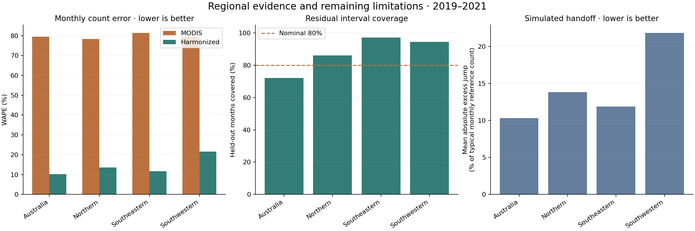
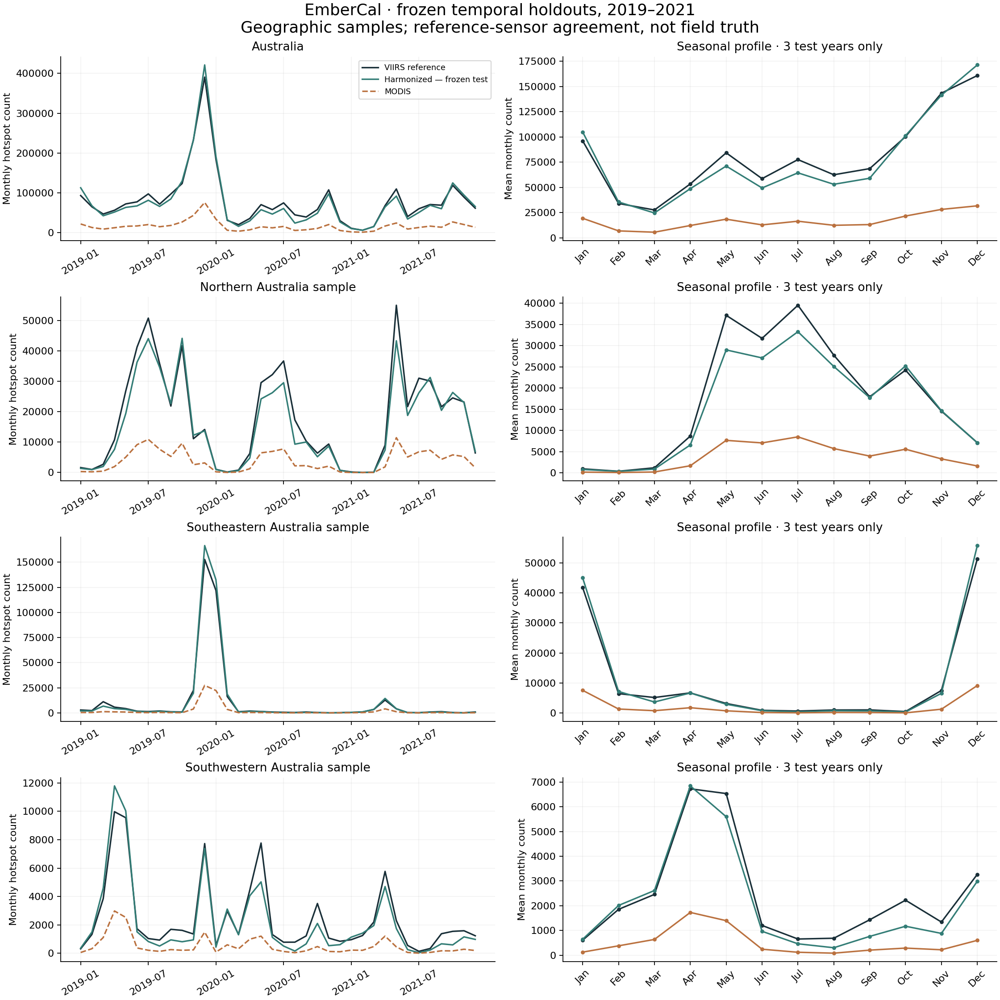

# Australian regional validation

Frozen temporal holdouts: 2019, 2020, 2021. No model refitting, downloads or operational data changes.

| Geographic sample | MODIS WAPE | Harmonized WAPE | Harmonized bias | 80% interval coverage | Mean excess handoff jump / typical month |
|---|---:|---:|---:|---:|---:|
| Australia | 79.4% | 10.2% | -4.4% | 72.2% | 10.3% |
| Northern Australia sample | 78.4% | 13.5% | -11.0% | 86.1% | 13.8% |
| Southeastern Australia sample | 81.3% | 11.6% | +3.6% | 97.2% | 11.9% |
| Southwestern Australia sample | 79.3% | 21.5% | -12.9% | 94.4% | 21.8% |

## Findings

- Australia: peak-month mismatches: none in these test years. Seasonal rank correlation: 0.993 harmonized versus 0.993 MODIS.
- Northern Australia sample: peak-month mismatches: 2019: Jul reference versus Oct harmonized. Seasonal rank correlation: 0.986 harmonized versus 1.000 MODIS.
- Southeastern Australia sample: peak-month mismatches: none in these test years. Seasonal rank correlation: 0.944 harmonized versus 0.958 MODIS.
- Southwestern Australia sample: peak-month mismatches: none in these test years. Seasonal rank correlation: 0.937 harmonized versus 0.930 MODIS.

Largest remaining monthly count error: Southwestern Australia sample (21.5% WAPE).

Count agreement improves in every sample, but seasonal shape is not uniformly improved. High interval coverage can mean overly broad intervals; low coverage means undercoverage. The simulated transition retains non-zero residual errors, so this is not proof of a seamless handoff. See individual and maximum handoff errors in results.json and transitions.csv.

Regional or seasonal model changes must be selected using training/calibration data, rather than optimizing these now-inspected test years. A further untouched evaluation is needed before claiming new improvements generalize.

## Scope

WAPE is sum of absolute monthly errors divided by sum of reference counts. Bias is signed error divided by reference total. Geographic boxes and effective grid-cell weights are recorded in results.json. These are broad geographic samples, not independently verified vegetation classes. Test years were excluded from training, selection and interval fitting; these geographic locations were not excluded from training.

## Season and anomaly diagnostics

regional-series.png shows all 36 test months and their three-year mean seasonal profile. results.json records annual peak months, cyclic peak error and seasonal rank correlation. Ties select the earliest peak. Anomaly agreement uses the other two test years' same-month reference median and a +/-20% band, excluding zero medians. The band is a diagnostic convention, not an established hazard threshold. Two peer years cannot validate operational percentiles or the application's multi-decade baseline.

## Simulated sensor transition

transitions.csv tests every adjacent held-out pair, including adjacent test-year boundaries. It compares a frozen MODIS prediction before the cut with VIIRS reference after the cut. Subtracting the reference-only change isolates the residual handoff error. Reference values are reused after the cut by design; that does not independently validate VIIRS or establish future performance. No smoothing is applied to hide a discontinuity. The typical-month denominator is each region's mean reference count across the 36 months.

## Limits and interpretation

Lower reference agreement error is useful but is not ground-truth fire detection accuracy. Cloud obscuration, viewing opportunities, missed fires, independent field/burned-area validation and spatially withheld evaluation remain unresolved. Small regional totals make percentage errors sensitive to individual months. Nominal 80% interval coverage must be assessed region by region, not assumed. No multiple-comparison significance or win/loss claims are made from these three years.

## Reproduce

Run `.venv/Scripts/python -m pipeline.regional_validation` from the project root. This overwrites only docs/regional-validation outputs. SHA-256 of the frozen source is stored in results.json. The current production calendar and model files are read-only inputs.

